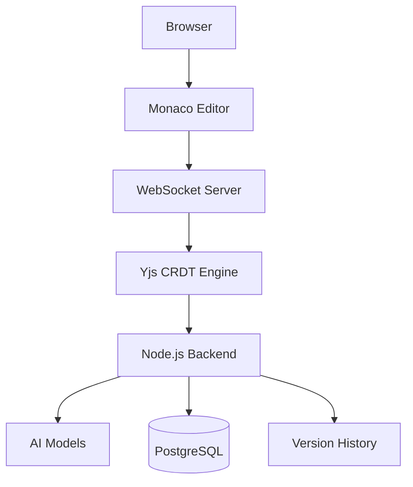

# **ochre.**

*build software without friction*

 

A collaborative software development workspace that unifies real-time coding, intelligent assistance, and continuous version history into a single platform.

 

Built for the **ShePreneur Startup Bootcamp 2026**.

 

[Overview](#overview) · [Principles](#principles) · [Architecture](#architecture) · [Features](#features) · [Tech Stack](#tech-stack) · [Roadmap](#roadmap)

---

> 📺 Watch the [demo video](https://www.youtube.com/watch?v=QoFjLHuWyBI)

---

## Overview

Software development today is fragmented. Building a single feature often requires switching between a code editor, GitHub, an AI assistant, and messaging platforms — and none of them share context with each other.

**Ochre** changes that. With Ochre, developers can:

- write code in the same editor, at the same time
- see teammates' cursors, selections, and updates in real time
- restore any previous version instantly
- search across the entire workspace without leaving the editor

> Instead of stitching tools together, Ochre treats the editor itself as the collaboration layer.

---

## Principles

| | |
|---|---|
| **O**rchestrate | One workspace for every workflow |
| **C**ollaborate | Teams stay in sync every step of the way |
| **H**armonise | Every tool works as one |
| **R**eason | Intelligence that understands context |
| **E**ngineer | Every build, engineered for production |

---

## Architecture

Real-time sync is powered by **Yjs** — a CRDT (Conflict-free Replicated Data Type) engine — so concurrent edits from multiple users merge automatically, with no manual conflict resolution required.

---

## Features

| Feature | Description |
|---|---|
|  &nbsp;Real-time Collaboration | Multiple developers edit the same project simultaneously and seamlessly. |
|  &nbsp;Version History | Every change is preserved automatically. Restore previous versions, compare edits, and track project evolution. |
|  &nbsp;Developer Presence | See who's online, where they're editing, and what files they're working on — without interrupting anyone's flow. |
|  &nbsp;Unified Workspace | Code, collaboration, version history, and project management — all in one place. |

---

## Tech Stack

| Layer | Technology |
|---|---|
| Frontend | React 19 + TypeScript |
| Styling | Tailwind CSS |
| Editor | Monaco Editor |
| Real-time Collaboration | WebSockets + Yjs (CRDT) |
| Backend | Node.js + Express |
| Database | PostgreSQL |
| Authentication | Custom — PBKDF2 password hashing + Base64 JWT |

---

## Roadmap

- [ ] AI Agent integration

---

*Built with ❤️ by team PromptShop.*

